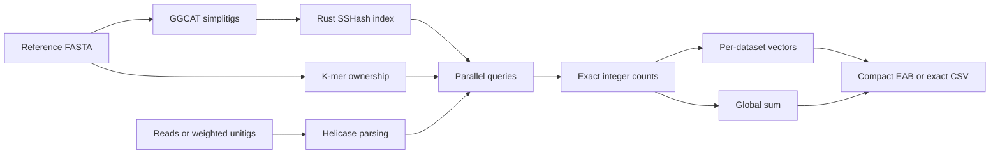

# Implementation reference

[README](../README.md) · [CLI recipes](CLI.md) · [Viewer guide](VIEWER.md)

## Index construction



## Counting rules

### Compression and record formats

Reference and query files can be uncompressed, gzip, xz, or Zstandard.

FASTA and conventional four-line FASTQ are supported. Compression is detected
from file contents, including concatenated gzip/xz/zstd streams. Files do not
need a particular extension for `quantify`; `.zst` and `.zstd` both work.

### Counting semantics

| Setting or rule | Behavior |
| --- | --- |
| k-mer length | Odd k from 3 to 63; default 31 |
| Strand | A k-mer and its reverse complement are equivalent |
| Ambiguity | Non-ACGT bases interrupt k-mers; flanking DNA is never joined |
| Shared sequence | K-mers assigned to multiple targets contribute to none; gene mode groups records by gene ID |
| Repeated sequence | Repetitions within one target retain that target as owner |
| `--mode reads` | Every matching occurrence contributes 1 |
| `--mode unitigs` | Every matching occurrence contributes the header abundance |
| `--mode auto` | Use abundance when present; otherwise count as reads |

Lowercase DNA is accepted. Sequence formatting whitespace is removed.
Occurrences are counted independently, without read deduplication or paired-end
fragment correction. Abundance is a **sum of uniquely assigned k-mer
observations**, without length or library-size normalization: it is not a
transcript count, TPM, or RPKM.

Supported mean-abundance tags are `ka:f:`, `km:f:`, `ka:i:`, and `km:i:`.
A tag may be the first token, including a header without an identifier. Mean
tags take precedence over `KC:i:`. With only `KC:i:`, the weight is
`KC / (sequence_length - assembly_k + 1)`; set `--unitig-k` when the assembly k
differs from the index k. Missing abundance fails in `unitigs` mode; malformed
abundance fails in both `unitigs` and `auto` modes.

Unitig weights apply uniformly along each sequence. Mean coverage cannot recover
the original per-k-mer read counts. Generate GGCAT unitigs with abundance support.

Weights are accumulated as fixed-point millionths; extra decimal places round
half up at ingestion. Each target/dataset is rounded to the nearest integer,
ties up, **after summing**. Reads use exact `u64` counts. Unitig/auto mode uses
`u64` millionths, allowing approximately 18.4 trillion weighted observations per
target/dataset. Overflow is reported explicitly. The shared reference table
includes the number of distinct usable k-mers for downstream normalization.

## GTF exon extraction

Only GTF `exon` features are extracted.

Coordinates are 1-based and inclusive;
negative-strand exons are reverse-complemented, including IUPAC ambiguity codes.
Repeated `(contig, start, end, strand)` intervals are merged across transcripts,
while identical sequences at different loci remain separate targets. Available
`exon_id` and `gene_id` attributes are retained in FASTA header descriptions.
Headers use generated IDs and genomic coordinates; special characters in names
are percent-escaped. Output follows genome contig order, then coordinate/strand
order within each contig, independently of GTF line order.

Use the matching **genomic** reference, with exactly the same contig names as
the GTF. Missing or duplicate contigs, invalid coordinates, and invalid exon DNA
are errors. Extraction streams genome records through Helicase and retains the
annotation plus the current contig in memory. Output files must be new and are
published only after successful extraction.

## Gene reference construction

Gene mode requires `gene_id` on annotated exons.

Within each gene, overlapping
exon intervals on the same contig and strand are merged. By default, separated
intervals remain separate FASTA records and no junction sequences are added.
All records bearing the same gene ID share one owner. A k-mer
present in multiple exons of one gene remains usable, while one shared between
different genes is excluded. This cannot be recovered by simply summing an
existing exon index; build a gene index to obtain the correct ownership.

The generated `reference-genes.fa` is retained in the index. Its first header
token is the percent-escaped GTF gene ID; annotations do not substitute gene
symbols. The reference table uses `gene_id,gene_name,length,unique_kmers,kmer_length`, with
1-based numeric IDs and the annotation's gene ID as the name. Length sums the
merged exonic intervals, and unique k-mers are counted once per gene.

Alternatively supply FASTA with `--level gene --genes genes.fa`. Records with
the same first header token are grouped into one gene; disconnected sequences
must be separate records, rather than concatenated. Duplicate gene IDs are
intentional in this mode. Length is the sum of supplied record lengths.

## Junction construction

`--junctions none` is the default.

`run` accepts the same options. Junction
options require `--level gene`, `--gtf`, and `--genome`; they are unavailable in
exon mode or when supplying a reference FASTA. Each annotated exon must have
exactly one `gene_id` and `transcript_id`. Transcript exons are sorted by genomic
coordinates in strand order; duplicate rows are deduplicated, and overlapping
exons within a transcript or inconsistent gene/transcript membership are errors.

Annotated mode uses up to `k-1` transcript bases on each side of each junction.
This includes k-mers spanning several annotated junctions around short exons.
All mode first merges intersecting exon intervals within each gene on the same
contig and strand. Each merged exon spans the minimum start to the maximum end;
overlap chains are merged transitively, while adjacent intervals without a
shared base remain separate. It then joins each merged exon's last `k-1` bases
to another's first `k-1` bases, respecting the gene's strand but allowing both
exon orders. It includes exon skipping and reverse-order/back-splice candidates. It excludes
self-pairs, overlapping exon pairs, and unannotated chains of three or more
exons. A short pair contributes only the k-mers its available sequence supports.
Candidate junctions are not evidence that those junctions occur biologically.

The limit counts merged exons per gene and applies only to exhaustive pair
generation. Genes above the limit still receive all their annotated junction
contexts. The work per expanded gene grows quadratically with its exon count. `metadata.json`
records the mode, limit, exon counting definition, annotated boundary count,
additional ordered boundary pairs, emitted sequence records, and expanded/
above-limit gene counts.

Junction records appear in `reference-genes.fa` with `kind=junction` and donor/
acceptor coordinates. They share their gene's owner and do not increase its
reported exonic length. The dictionary stores distinct canonical k-mers: repeats
within one gene count once, and k-mers shared between genes are excluded as usual.

## Normalization

Raw counts remain stored in compact vectors. Apply normalization when exporting
CSV or in the viewer; no separate normalized index is required.

| Option | Value for target `e` in dataset `d` |
|---|---|
| `none` (default) | `count(e,d)` |
| `cpm` | `count(e,d) × 1,000,000 / total_kmers(d)` |
| `coverage` | `count(e,d) / kmer_length(e)` |
| `length-cpm` | `count(e,d) × 1,000,000 / (total_kmers(d) × kmer_length(e))` |

`length-cpm` combines the two corrections. These are k-mer observation rates,
not transcript TPM; length-corrected values do not sum to one million.

`total_kmers` counts **all valid ACGT k-mer occurrences** in the original input,
including unmatched and shared k-mers. Unitig occurrences use the same header
abundance weights as quantification. Totals retain six-decimal fixed-point
precision before target counts are rounded or quantized. Dataset and target
selection never recompute these denominators from the displayed subset.

`kmer_length` sums `max(0, run_length - k + 1)` over unambiguous exonic runs.
Disconnected exons are counted separately; no artificial k-mers span their gaps.
In GTF gene mode, overlapping exon intervals are merged before length counting.
Junction contexts add evidence to counts but do not increase exonic length.
For supplied gene FASTA, lengths sum the supplied records. Repeated sequences
contribute repeated positions: this length differs from `unique_kmers`, which
counts distinct usable canonical k-mers.

```bash
expresso export --input results --output normalized-csv \
  --normalization length-cpm --compression zstd --with-names

# Also works directly from a packed index, including for target/dataset subsets.
expresso export --input examples/viewer/toy.eai --output normalized-toy \
  --normalization length-cpm --dataset sample_A1 --target GENE_A \
  --compression none
```

In the viewer choose **Normalization → CPM / target k-mer length**, then click
**Update heatmap**. Values, colors, abundance sorting, and both CSV exports
use that normalization. Log values and number formatting are applied afterward;
CSV retains fractional values before display formatting. Min/max bounds still
apply to decoded **raw counts**, in both the CLI and viewer. Hiding empty rows
checks raw nonzero counts. The toy's `GENE_A / sample_A1` becomes
`4080 × 1,000,000 / (4862 × 34) = 24681.20115178939` (approximately `2.47e+4`).
Normalization is applied to requested values. The active view determines the
scan scope: a heatmap page, a selected distribution, or a whole-matrix summary.

The global vector uses the **pooled full input k-mer total** of successful
datasets, not the sum or mean of independently normalized values. Raw stored
summary statistics are not normalized: deselect them in the viewer; normalized
CLI export omits their columns. Zero counts with zero denominators return zero;
nonzero counts with zero denominators produce an error.

New indexes record k-mer lengths and new quantifications record dataset totals.
Older indexes/results still support raw viewing/export. `cpm` requires
requantification when totals are missing; `coverage` and `length-cpm` require
rebuilding the reference index and requantifying when target lengths are missing.
Packing an old result does not invent missing denominators. Normalized values
still inherit any approximation in the compact abundance counts.

## Compact output and CSV semantics

### Compact EAB: the default

```text
results/
├── datasets/
│   ├── sample_A.eab.zst
│   └── sample_B.eab.zst
├── global.eab.zst
├── exons.csv.zst
└── manifest.json
```

EAB v1 stores target names **once**, in `exons.csv.zst`. Each vector contains
one code per target in the same order, an integer codebook, a reference SHA-256,
and a CRC checksum. The manifest describes coverage, output files, counting
metrics, and measured approximation errors.

`--bits` accepts **2–16**, default **8**. Eight bits means one payload byte per
target before compression, plus a small header/codebook. Larger values use a
logarithmically spaced codebook fitted to each vector's observed maximum.

- Zero/nonzero status is preserved exactly at every supported width.
- At 8 bits, counts **0–15 are exact**. If the vector maximum is at most 255,
  every count in that vector is exact.
- Larger counts are approximate. More bits generally improve precision; error
  depends on the vector's range and is recorded in the manifest.
- Counts are not clipped to a fixed abundance ceiling.
- Quantization is lossy; the subsequent zstd/gzip/xz compression is lossless.

The design draws on the idea of logarithmic abundance discretization used in
[REINDEER2](https://github.com/Yohan-HernandezCourbevoie/REINDEER2), with its
own encoding and per-vector codebooks. Codes from different vectors must be
decoded before comparing or adding them.

### Global sum and optional statistics

**The global sum is always produced**; no extra flag is required. It sums exact
rounded dataset counts, then independently quantizes that total for compact
output. Consequently, adding decoded dataset values may not reproduce the
decoded global vector exactly.

`--stats` additionally writes mean, median, minimum, maximum, and detected-dataset
count under `statistics/`. Statistics include zero values and are computed from
exact counts before quantization. The detected-dataset count can therefore be
approximate, even though individual vectors preserve presence/absence exactly.
Exact statistics require temporary disk space proportional to targets × datasets.

### Export only what you need

```bash
# Every dataset and the global sum; one abundance column per dataset.
expresso export --input results --output csv --compression zstd

# Selected dataset, plain CSV; repeat --dataset to select more.
expresso export --input results --output selected \
  --dataset sample_A --compression none

# Global sum only, with IDs and names.
expresso export --input results --output global-csv --global-only --with-names
```

Without `--with-names`, dataset CSVs have a single `abundance` column and one
integer per target. Global CSVs also include any requested statistics. With
`--with-names`, target ID and name precede abundance (exon or gene columns). Export writes the selected
reference rows and records source coverage in its manifest.

Select targets, datasets, and an inclusive range of decoded counts:

```bash
expresso export --input results --output subset-csv \
  --target-list selected-exons.txt --dataset-list selected-datasets.txt \
  --min-value 10 --max-value 10000 --compression zstd

# Names or explicit original 1-based IDs; flags can be repeated.
expresso export --input gene-results --output selected-genes \
  --gene ENSG00000123456.7 --target-id 42 --dataset sample_A
```

Lists contain one exact name per line; blank lines and `#` comments are ignored.
Compressed lists are accepted. `--target` (aliases `--exon`, `--gene`) selects
names, `--target-id` selects numeric IDs, and `--target-list` (alias `--exon-list`)
selects names from a file. These target selections are combined as a union.
Duplicate names select all matching targets; numeric IDs distinguish them.
`--dataset-list` and repeated `--dataset` are combined likewise. Unknown names,
out-of-range IDs, empty list files, and reversed bounds are errors.

A target or value filter automatically adds ID/name columns and preserves
original IDs and reference order. Bounds omit nonmatching rows **independently
in each dataset CSV**; they do not clip counts or change the global sum. Bounds
on global export apply to its abundance column. The accompanying reference
table lists selected targets before the value filter; each CSV identifies its
surviving rows. Dataset selection exports those datasets only; without it,
all datasets plus the original global sum are exported. Use `--global-only`
for just the global sum and available statistics.

CSV export returns decoded representatives: it cannot restore values discarded
by quantization. To retain exact original counts from the start, quantify with
`--format csv`. This writes target ID, name, and abundance in every dataset CSV
and an exact global CSV; repeating names makes these files much larger.

| `--compression` | Compact vectors | CSVs |
| --- | --- | --- |
| `zstd` (default, level 3) | `.eab.zst` | `.csv.zst` |
| `gz` | `.eab.gz` | `.csv.gz` |
| `xz` | `.eab.xz` | `.csv.xz` |
| `none` | `.eab` | `.csv` |

This option is independent of input compression. The shared compact reference
is `exons.csv.zst` or `genes.csv.zst`; exact CSV output uses the uncompressed table.

## Fold-change definitions

In the heatmap, choose **Cell values → Fold change** or **Log₂ fold change**,
then click **Update heatmap** to compute the reference means. For each
exon, gene, or transcript independently:

```text
target mean = sum of known expression values / number of known selected real datasets
fold change = expression / target mean
log₂ fold change = log₂(expression / target mean)
```

The reference uses **all selected real datasets**, including those on other
pages. It includes known zeros and excludes missing transcript estimates.
Global sums and stored statistic vectors are excluded from the mean and show
blank cells in these modes. Select at least one real dataset. Min/max bounds
and hidden rows do not change the reference. Normalization is applied before
computing the mean, using the chosen transcript metric when applicable.

For the gene toy, select `GENE_A` and the four `sample_*` datasets. Its mean is
1,827.5; `sample_A1` therefore has fold change **2.23256** and log₂ fold change
approximately **1.15870**. Changing the dataset selection changes the reference
mean. A single known dataset with positive expression has FC 1 and log₂ FC 0.

The contrasting color means below average, white means average (FC 1 / log₂
FC 0), and the selected main color means above average. Both modes use symmetric log₂ color distances around the mean;
the ordinary color-scale selector is disabled. Colors scale to the visible page,
with zero expression saturating at the below-mean end. Hover a cell for its source
value, raw count, target mean, and number of known reference datasets.

No pseudocount is added. With a positive mean, zero expression has FC 0 and
log₂ FC **−∞**. An all-zero target's mean is zero, so both ratios are undefined
and shown as **—**, just like missing estimates. CSV exports write `-Infinity`
for log₂ FC of zero and leave undefined/missing cells blank; the streaming export
omits undefined/missing entries. Fold-change exports use the applied cell mode,
without number formatting, and their filenames include `fold` or `log-fold`.
The long CSV column is `fold_change` or `log2_fold_change`.

Computing the means scans the selected targets/datasets on request and retains
only per-target totals and known counts, alongside the existing ordering
summaries. It never stores the whole matrix. Paging and switching between FC
and log₂ FC reuse the means. Selection, normalization, or transcript-metric
changes invalidate them. Sorting and target summaries continue to use source
abundance; dataset-ranking bars continue to show expression shares.

**Hide all-zero rows** checks every selected dataset, including datasets on other
pages. Sort targets and datasets by original order, name, total abundance,
maximum abundance, or number of nonzero counts. Name sorting reads metadata only;
zero-row hiding and abundance sorting scan the selected counts once, on request,
in chunks of at most 4,096 targets. The viewer retains per-target/per-dataset
summaries and one packed dataset vector, without retaining the full matrix.
Summaries are reused until the target/dataset selection or normalization changes. Raw totals and
comparisons preserve integer precision above `u64::MAX`; normalized calculations use floating point. Sorting uses values
across the full selection, before min/max filtering; ties preserve original IDs.
Choose the options, then click **Update heatmap** or **Apply view options**. **Cancel operation**
stops loading/scanning/exporting between chunks. CSVs follow the applied order
and exclude rows hidden by the all-zero filter.

Opening a file first reads its catalogue, selects all targets and real
datasets, and lands on **Global overview**. Tiny matrices (at most 10,000 cells
and 32 real datasets) receive an automatic whole-matrix summary. Larger indexes
show dimensions immediately and wait for **Update summary**; abundance blocks
are read when a view requests them. Each requested scan streams compressed
dataset vectors and retains only summaries and visible pages. Global/statistic
vectors remain optional in the heatmap and are excluded from matrix summaries. Selections have no
200 × 100 size cap: search, paste lists, or select individual targets/datasets.

## Summary calculations

The table always reports **Known datasets**, **Missing datasets**, and
**Distribution N**. Missing transcript estimates are excluded from all
calculations and never replaced by zero. Above-threshold percentages divide by
the known dataset count. When no values are known, total/mean/quantiles remain
missing. Excluding zeros changes mean, median, percentiles, min/max, and standard
deviation; it does not change total, nonzero count, or the threshold denominator.
An all-zero target therefore has total zero but no distribution statistics when
zeros are excluded. The median always uses the arithmetic midpoint for even N,
independently of the chosen percentile definition.

Heatmap min/max bounds and hidden-row settings do not discard observations or
targets from summaries: the panel uses the explicit target selection and its
own dataset scope. View normalization, when requested, uses full dataset totals
and target lengths before statistical calculations. Log cell values and number
formatting affect presentation afterward; counts of datasets and percentages
are not log transformed. Summary colors use each statistic's maximum across
all summarized targets, so their scale is stable across target pages.

Raw integer totals, minima/maxima, and nearest-rank quantiles preserve `BigInt`
precision. Fractional means, even medians, and interpolated integer percentiles
are rounded to six decimal places using integer arithmetic. Normalized and
transcript summaries use floating point; standard deviation uses a stable
population variance calculation. Summaries of EAB vectors use their decoded
approximate counts. Their total may differ from the independently quantized
global vector, which was formed before per-dataset quantization.

Exact quantiles keep a value-frequency histogram for a bounded **target batch**,
then release it before processing the next batch. The batch adapts to dataset
count, with at most 128 targets and roughly one million potentially distinct
values at a time. Above one million datasets, exact mode necessarily permits
the histogram for one target to exceed that budget. Memory can therefore grow
with a single target's distribution, but the whole abundance matrix is never
retained. Sampled mode caps each target's quantile sample at the configured size;
totals, means, threshold counts, and standard deviation still use every known
value. Sampled medians/percentiles are labeled approximate when N exceeds the
sample size, while P0/P100 remain observed endpoints. Sampling uses no fewer
dataset reads than exact mode; it controls quantile memory, not scan duration.

Scans run only on request and support **Cancel operation** between dataset
blocks. Many targets can require multiple passes over the selected datasets.
The table pages through 100 targets at a time and retains only summary results.
**Summary CSV** exports every summarized target in the applied summary order,
with selected statistics, scope, threshold, zero handling, percentile definition,
and approximation flags. Values are exported before display formatting/logs;
missing results are blank. The CSV is assembled from summary records, not from
the original count matrix.

## Browser storage and file formats

The heatmap displays pages of 100 targets × 25 datasets.

Use the navigation
buttons or jump directly to target/dataset positions in your selection. Normal
paging reads only the visible datasets and returns only visible target counts.
Requested zero-row hiding and abundance sorting additionally stream the selected
counts into summaries; the selected matrix is never retained in RAM. Colors scale to
the current page, so compare cells on that page using its legend.

With EAI v1, each dataset is one zstd frame. Reading any target from it requires
decompressing that dataset block; the viewer cannot seek directly to a target
inside the compressed frame. Rust/WebAssembly validates the EAB reference,
checksum, padding, and codes and keeps **one bit-packed vector** cached, rather
than a full array of decoded counts. Changing dataset evicts that cache. At 8
bits, its abundance payload is approximately one byte per reference target.
Only requested counts cross back to the page, as decimal strings; JavaScript
`BigInt` preserves the entire 64-bit integer range. No other abundance vectors
are read until requested. WebAssembly retains its peak linear-memory capacity
for reuse even after allocations are freed.

With transcript EAI v2, the same worker validates EFV checksums/reference IDs and
caches one lossless `f64` vector (eight bytes per transcript), replacing it when
the dataset or metric changes. Explicit missing sentinels cross to JavaScript as
nulls. The catalogue loads first; the landing overview scans only tiny matrices
automatically. Other metric/dataset blocks remain on disk until a requested
view needs them.

**Visible CSV** exports the displayed target-by-dataset matrix, with blank
fields for out-of-range cells. **Full selection CSV** streams the entire
selection in long format (`target_id,target_name,dataset,abundance`, using exon
or gene column names, or transcript names and the chosen metric). It applies
inclusive bounds and omits nonmatching/missing rows.
In fold-change modes, both exports use the applied ratios/log₂ ratios instead
of abundance, and undefined values are also blank or omitted.
Export processes one dataset at a time, extracts up to 512 requested counts per
chunk, and writes to local browser temporary storage; it does not accumulate the
CSV or selected matrix in RAM. Download the finished file, then use **Clear
temporary CSV** to remove that local copy. Temporary export storage is subject
to the browser's disk quota. CLI exports remain one CSV per dataset.

Memory therefore depends on the catalogue, selected ID lists, one dataset's compressed/bit-packed
vector and decompressor, optional row/column summaries or target-batch distributions,
and the current page/scan/export chunk, rather than the
whole abundance file or selected matrix. The catalogue must still fit in memory
and EAI v1/v2 limit it to 256 MiB; this is a metadata limit, not an abundance-file
size limit. Open through `expresso view`, rather than `file://`, so WebAssembly,
workers, local temporary storage, and checksums are available.

If a file fails to open, confirm that it is a complete `.eai` produced by
`pack` or `--viewer-index`. To diagnose it independently of the browser, try a
CLI export into a new directory. If **Full selection CSV** reports that local
storage is unavailable, use a browser with Origin Private File System support
or CLI export; **Visible CSV** remains available. Large exports may require
free local disk space and sufficient browser storage quota. Use the localhost
URL printed by `view`, keep its process running, and refresh after rebuilding
EXPRESSO to load the updated bundled application.

The app's Rust source and a prebuilt WASM module are included. To rebuild it:

```bash
rustup target add wasm32-unknown-unknown
env RUSTFLAGS= cargo build --manifest-path viewer/wasm/Cargo.toml \
  --target wasm32-unknown-unknown --release --locked
cp viewer/wasm/target/wasm32-unknown-unknown/release/expresso_viewer.wasm \
  viewer/expresso_viewer.wasm
cargo build --release --locked
```

Empty `RUSTFLAGS` overrides the native CPU setting for the WASM build. EAI v1
starts with `EXPREAI1`, little-endian 64-bit catalogue offset and length, then
independent zstd-compressed EAB blocks. A trailing JSON catalogue records target
metadata, vector kind/name/offset/length, and coverage; a SHA-256 follows it.
The same EAB validation code is compiled into the native tool and WASM decoder.
Transcript EAI v2 uses `EXPREAI2` with the same catalogue-offset envelope. Its
catalogue lists two zstd/EFV blocks per dataset. EFV v1 starts with `EXPREFV1`,
a 32-byte target-table reference hash, a little-endian `u64` target count,
then little-endian `f64` slots and a trailing CRC32. Missing values use the
canonical quiet-NaN bit pattern `0x7ff8000000000000`; all other NaNs, infinities,
and negative values are rejected. This is a distinct lossless format for EM
results, rather than quantized EAB.

## Failed datasets

Normally, a dataset error stops the run. `--keep-going` records input/counting
failures and continues with the rest. Failed datasets contribute **no partial
counts** to the global sum. The final manifest lists their errors and records
`coverage.complete: false`. CSV export preserves this information.

Output/aggregation errors remain fatal. An all-failed run is not published.
`--keep-going` cannot be combined with `--stats`. Invalid dataset lists and
missing paths are rejected before processing. There is no automatic checkpoint
resume; completed vectors are staged until the overall run is published.

## Validation and rebuilding

```bash
cargo fmt --check
cargo test --locked
cargo clippy --all-targets --locked -- -D warnings
env RUSTFLAGS= cargo test --manifest-path viewer/wasm/Cargo.toml --locked
```

An optional Rust browser test checks a 300-target × 151-vector selection,
on-demand reads, page navigation, full streamed CSV, and 64-bit values. With
Firefox and geckodriver installed, start the driver in another terminal and run:

```bash
geckodriver --host 127.0.0.1 --port 4444
# In another terminal:
cargo test --test viewer_browser --locked -- --ignored
```

Rust tests cover the EAB codecs and bit widths, integer boundaries, integrity
checks, exon and gene ownership, weighted counting, filtered export, portable
index round trips, global sums, and failures. Junction tests compare annotated
transcripts and ordered merged-exon pairs against an independent k-mer oracle.
Isoform tests independently reconstruct canonical feature memberships and
multiplicities, verify exact compressed counts, and fit exon skipping, identical
profiles, and rank-deficient examples. Count-only inference is tested after the
sequence files and SSHash dictionary have been removed.
The viewer example test regenerates the toy index from its FASTA inputs and
checks both generated and bundled portable files against the documented counts.
Integration tests use the bundled GGCAT library with an empty `PATH` and compare
counts with an independent canonical-k-mer oracle. No separate tools or Python
scripts are needed to run the tests.
Transcript packaging tests check both metrics, missing values, source coverage,
and failure atomicity. The optional Firefox test covers configurable summaries,
large integer arithmetic, bounded samples, selected/normalized scopes, summary
CSV, transcript metric switching, separate tabs, whole-matrix overview,
dataset-list paging, target profiles, large-file opening without abundance
reads, and palette changes without additional abundance reads.
